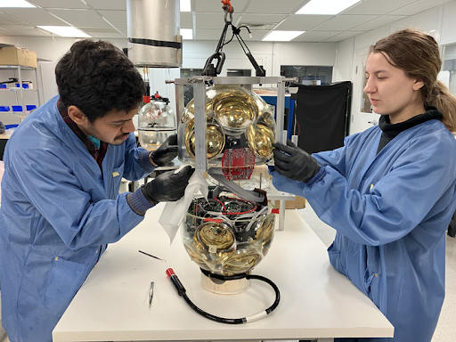

I work on large-scale data analysis and instrumentation development in high-energy astrophysics, with a focus on particle detection and signal processing. My recent collaborations include work on the [IceCube](https://icecube.wisc.edu/) Neutrino Observatory at the South Pole and the Compact Muon Solenoid (CMS) at CERN, Geneva. I am particularly interested in measurements of the astrophysical neutrino spectrum and what this tells us about cosmic ray accelerators from a multimessenger perspective.

<!-- - [ Astroparticle Physics with Cosmic Neutrinos](#astroparticle)
- [ Instrumentation Development for IceCube Upgrade](#instrumentation)
- [ Calibration of South Pole ice using embedded cameras](#ice-calibration)
 -->
 <!-- Quick Jump Navigation -->

  <a href="#astroparticle" class="research-pill"><i class="fas fa-atom"></i> Cosmic Neutrino Spectrum</a>
  <a href="#upgrade" class="research-pill"><i class="fas fa-camera"></i> IceCube Upgrade Calibration</a>
  <a href="#gen2" class="research-pill"><i class="fas fa-solar-panel"></i> IceCube-Gen2 &amp; Polar Operations</a>

---

## Astroparticle Physics with Cosmic Neutrinos

  

    
  

    

      Neutrinos are almost massless neutral particles that interact only weakly with matter, traveling through the Universe unimpeded by dust and undeflected by magnetic fields to point directly back to extreme cosmic-ray accelerators. The IceCube Neutrino Observatory instruments a cubic kilometer of deep glacial ice at the South Pole to detect the Cherenkov radiation produced by these rare interactions.
    

    

      My research focuses on isolating astrophysical neutrino signals in IceCube data and precision-mapping their energy spectrum and origins. Using advanced selection and modeling techniques, including machine learning methods and multidimensional likelihood estimation, my collaborators and I uncovered evidence that the cosmic neutrino spectrum deviates from a simple power law, revealing spectral curvature that constrains the radiation fields and physical environments of their sources.
    
    
  

    

      <!-- Miniature Gold Nobel Medallion SVG -->
      
      

        
          2026 Nobel Prize in Physics &bull; IceCube Collaboration
         
        Building on the Nobel-recognized discovery of high-energy astrophysical neutrinos, led by IceCube Principal Investigator Francis Halzen, my work maps the fine spectral structure of this cosmic flux to uncover its hidden engines.
      

    

    

      <a href="https://icecube.wisc.edu/" target="_blank" rel="noopener" class="research-pill"><i class="fas fa-external-link-alt"></i> IceCube Collaboration</a>
    

  

<!-- ## Astroparticle Physics with Cosmic Neutrinos

 

    
  

  

    

      Neutrinos are almost massless neutral particles, which interact only weakly with matter as they travel through. This makes them both ideal cosmic messengers, as they travel through the Universe unimpeded by intervening matter and undeflected by any electromagnetic fields. As such, once detected, they point back toward their sources, which are theorized to be cosmic ray accelerators, some of the most extreme environments in the Universe. The same characteristics which make the neutrino an ideal messenger make it very difficult to detect. In fact, as a weakly interacting particle, neutrino interactions are very rare, requiring a large flux and a large volume of detection medium to observe. When they do interact, however, we observe a shower of charged particles, which in a transparent medium manifest as Cherenkov radiation. The IceCube Neutrino Observatory uses the glacial ice at the South Pole as a Cherenkov medium to observe these neutrino events.
      My research focuses on identifying astrophysical neutrino signals in IceCube data and constraining the energy spectrum and possible sources. I use machine learning and maximum likelihood estimation techniques to study event directions, energies, and flavors. My collaborators and I found evidence that the spectrum of cosmic neutrinos arriving at Earth has structure beyond a simple power law, an exciting result with numerous implications for the sources of astrophysical neutrinos.
    

  

 -->
---

## Instrumentation Development

  

    
  

  

  

    I have been a lead member of a team developing new optical detector prototypes for IceCube-Gen2, a high-energy expansion to the current IceCube detector, aiming to boost sensitivity to PeV-scale neutrinos, along with a great enhancement to the neutrino source detection sensitivity. I have contributed to modelling, design, testing, and firmware development for the Long Optical Module (LOM), a candidate for IceCube-Gen2. Twelve prototypes were deployed during the upcoming 2025-26 IceCube Upgrade deployment season in a successful field test. We plan to develop these into 
  

 

---

## South Pole Ice Imaging and Calibration

  

    
  

  

  

    One of the major science goals of the <a href="https://icecube.wisc.edu/news/press-releases/2026/02/the-icecube-neutrino-observatory-gets-a-major-upgrade-beneath-the-ice/" target="_blank" rel="noopener">IceCube Upgrade</a>, a recent expansion of the current IceCube detector to study GeV-scale neutrino oscillation measurements
    I am currently focusing on the development of firmware for the Gen2-DOM, an expansion of the current IceCube detector to both improve sensitivity to PeV, and to better characterize the optical properties of the ice at the South Pole. I am leading the campaign to perform the optical calibration and modelling of South Pole ice using cameras incorporated into the ice. This involves firmware development tasks, optical bench testing, and the commissioning of a 3D laser scanning system to analyze instrument response.
  

  

      <a href="https://icecube.wisc.edu/news/press-releases/2026/02/the-icecube-neutrino-observatory-gets-a-major-upgrade-beneath-the-ice/" target="_blank" rel="noopener" class="research-pill"><i class="fas fa-newspaper"></i> IceCube Upgrade Press Release (Feb 2026)</a>
    

## IceCube Upgrade Camera Calibration & Geometry

  

    
  

  

    

      Precision neutrino oscillation and low-energy reconstruction depend on knowing the exact positions, orientations, and optical properties of every sensor frozen deep into the South Pole ice. Following the deployment of the <a href="https://icecube.wisc.edu/news/press-releases/2026/02/the-icecube-neutrino-observatory-gets-a-major-upgrade-beneath-the-ice/" target="_blank" rel="noopener">IceCube Upgrade</a>, I led the image-based geometry calibration across 409 camera-equipped optical modules.
    

    

      By triangulating inter-string LED flashers and hole-ice refreeze features across multi-camera images, this pipeline independently constrains horizontal module coordinates, decouples vertical string-depth offsets from individual module tilts, and characterizes local ice scattering in the drill column.
    

    

      <a href="https://icecube.wisc.edu/news/press-releases/2026/02/the-icecube-neutrino-observatory-gets-a-major-upgrade-beneath-the-ice/" target="_blank" rel="noopener" class="research-pill"><i class="fas fa-newspaper"></i> IceCube Upgrade Press Release (Feb 2026)</a>
    

  

---

  <h3> This should zoom in when you scroll!</h3>
  
If this doesn't animate, AOS isn't loading. We'll fix it.

